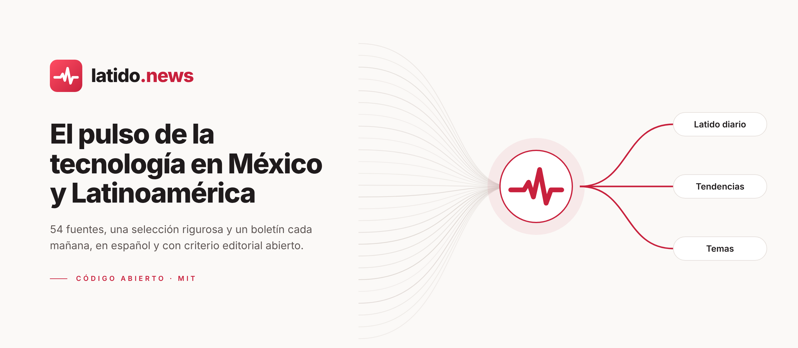
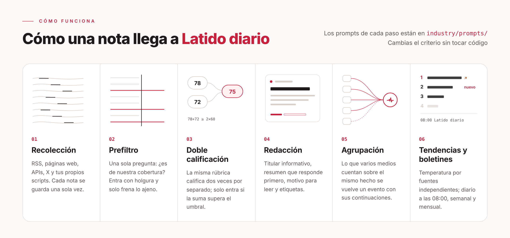
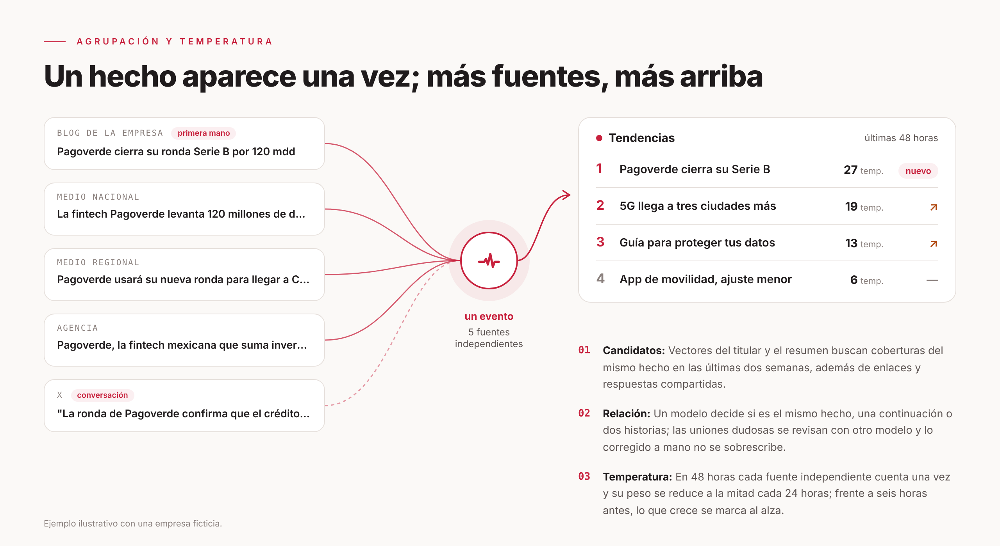

<p align="center">
  <picture>
    <source media="(prefers-color-scheme: dark)" srcset="docs/assets/banner-dark.png">
    
  </picture>
</p>

<p align="center">
  <a href="LICENSE"></a>
  
  
  
  <a href="https://latido.news"></a>
</p>

<p align="center">
  <b>Technology, business, energy and electric mobility in Mexico and Latin America.</b><br>
  A Spanish-language news radar that reads dozens of outlets, clusters the ones telling the same story and delivers what is actually worth reading every morning.
</p>

<p align="center">
  <a href="README.md">Español</a> · <b>English</b>
</p>

<br>

## What Latido is

[Latido](https://latido.news) is a news radar for technology, business, energy and electric mobility written in Spanish, with a clear editorial priority: Mexico first, then Latin America, then the global stories that actually move the region. It covers artificial intelligence, products and gadgets, startups and fintech, telecom, cybersecurity, digital regulation, video games, investment, industry, energy projects and electric transport.

Every day it collects items from up to 89 configured sources (54 original feeds plus 20 for business, 10 for energy and 5 for electric mobility), screens them with a language model, scores the promising ones twice and independently, and writes an informative headline and an answer-first summary for each. When several outlets report the same story, it clusters them into one **event** and ranks it by how many independent sources are talking about it. It publishes a daily briefing every morning, a weekly one on Mondays and a monthly one on the 1st.

This repository is the whole site: the public website, the admin, the selection pipeline, the clustering and heat algorithms, and **the full text of every prompt and selection threshold**, so anyone can audit how stories are chosen. The interface, the documentation and everything the site writes are in Spanish.

## How it works

<picture>
  <source media="(prefers-color-scheme: dark)" srcset="docs/assets/how-dark.png">
  
</picture>

An item arrives from its source, is deduplicated and pre-screened. Items that might matter are scored twice on the same rubric, get a headline and summary, are clustered with other coverage of the same story and add to its heat. An item enters the selection only if its score clears the threshold for its source tier and it doesn't repeat something already selected. Every step's prompt lives in [`industry/prompts/`](industry/prompts/), so changing the editorial standard doesn't mean changing code.

<picture>
  <source media="(prefers-color-scheme: dark)" srcset="docs/assets/cluster-dark.png">
  
</picture>

**Heat** is computed per event, not per article: within 48 hours each independent source counts once, halving every 24 hours, so what ranks at the top is what many different people are really talking about.

## Run it

You need [Docker](https://docs.docker.com/get-started/get-docker/), [Node.js 24](https://nodejs.org/en/download) and an API key for any OpenAI-compatible model API (DeepSeek by default).

```bash
git clone https://github.com/PandiCloudDev/latido.git
cd latido
node scripts/init-env.ts --llm-key <your model API key>
docker compose up -d --build
```

Open <http://localhost:3000>. The admin is at `/admin` with the password set as `ADMIN_PASSWORD` in `.env`. Deployment details are in [docs/deploy.md](docs/deploy.md) (in Spanish).

## Credits

Latido is a project by [Pandi.Cloud](https://pandi.cloud), an independent Mexican developer with no ties to any publishing company. It is built on [AIHOT](https://github.com/KKKKhazix/AIHOT), the open-source engine created by 数字生命卡兹克 (Khazix) under the MIT License, adapted for Spanish and the Latin American market. Latido does not use AIHOT's name or logo.

## License

The code is under the [MIT License](LICENSE). The Latido name and logo are not covered by the license. Fonts have their own licenses; see [NOTICE](NOTICE).
