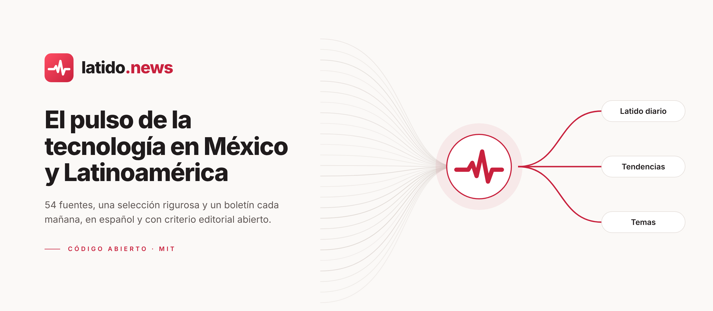
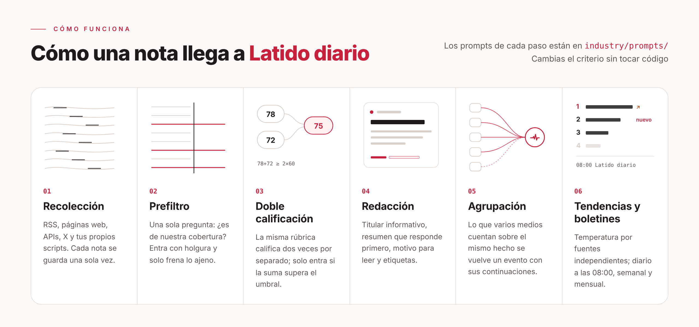
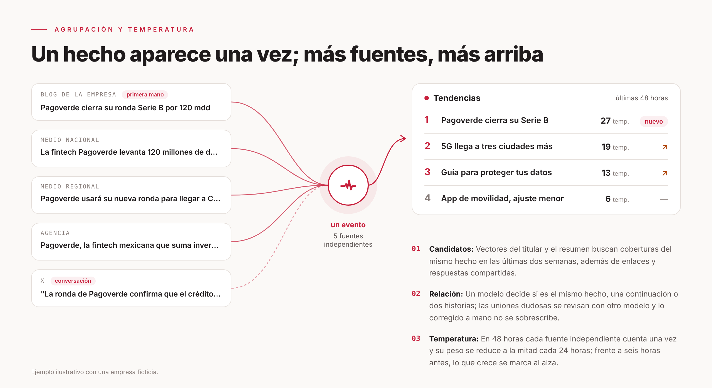

<p align="center">
  <picture>
    <source media="(prefers-color-scheme: dark)" srcset="docs/assets/banner-dark.png">
    
  </picture>
</p>

<p align="center">
  <a href="LICENSE"></a>
  
  
  
  <a href="https://latido.news"></a>
</p>

<p align="center">
  <b>Tecnología, negocios, energía y electromovilidad en México y Latinoamérica.</b><br>
  Un radar de noticias en español que lee decenas de medios, agrupa lo que cuentan lo mismo y entrega cada mañana lo que de verdad vale la pena leer.
</p>

<p align="center">
  <b>Español</b> · <a href="README.en.md">English</a>
</p>

<p align="center">
  <a href="#ponlo-en-marcha">Ponlo en marcha</a> ·
  <a href="#cómo-funciona">Cómo funciona</a> ·
  <a href="#adáptalo-a-otro-sector">Adáptalo a otro sector</a> ·
  <a href="#documentación">Documentación</a>
</p>

<br>

## Qué es Latido

[Latido](https://latido.news) es un radar de noticias de tecnología, negocios, energía y electromovilidad escrito en español, con una prioridad editorial clara: primero México, después Latinoamérica y, al final, lo global que sí mueve el tablero en la región. Cubre inteligencia artificial, productos y gadgets, startups y fintech, telecomunicaciones, ciberseguridad, regulación digital y videojuegos, además de inversión, industria, proyectos energéticos y transporte eléctrico.

Todos los días recoge notas de hasta 89 fuentes configuradas, las filtra con un modelo de lenguaje, califica dos veces y por separado las que prometen, y redacta para cada una un titular informativo y un resumen que responde primero a la pregunta del lector. Cuando varios medios cuentan la misma historia, la agrupa en un solo **evento** y la ordena según cuántas fuentes independientes están hablando de ella. Cada mañana publica el boletín *Latido diario*, los lunes el semanal y el día 1 de cada mes el mensual.

Este repositorio es el sitio completo: la web pública, el panel de administración, el flujo de selección, el algoritmo de agrupación y de temperatura, y **el texto íntegro de cada prompt y de cada umbral de selección**, para que cualquiera pueda auditar con qué criterio se elige lo que se publica.

## Criterio editorial

Latido no intenta publicar todo, sino lo que un lector interesado en tecnología necesita saber hoy. Por eso los nombramientos de directivos siempre entran, los comunicados solo pasan si contienen un hecho noticioso, los rumores solo se toman de fuentes confiables y se marcan como tales, y los titulares buscan informar con gancho sin caer en el clickbait. Ese criterio vive en [`industry/prompts/`](industry/prompts/) y en [`industry/selection.ts`](industry/selection.ts), no en el código, así que se puede discutir, versionar y calibrar como cualquier otra decisión editorial.

## Cómo funciona

<picture>
  <source media="(prefers-color-scheme: dark)" srcset="docs/assets/how-dark.png">
  
</picture>

Una nota llega desde su fuente, se revisa que no esté duplicada y pasa por un prefiltro que solo pregunta si pertenece a la cobertura de Latido. Las que podrían importar se califican dos veces de forma independiente con la misma rúbrica, reciben titular y resumen, se agrupan con otras coberturas del mismo hecho y suman a su temperatura. Una nota entra a la selección únicamente si su calificación supera el umbral de su nivel de fuente y no repite algo que ya se seleccionó. El boletín diario se arma por reglas con lo más importante del día, mientras que el semanal y el mensual se construyen a partir de los diarios. Los prompts de cada paso están en [`industry/prompts/`](industry/prompts/), de modo que cambiar el criterio no exige tocar código; el detalle está en [Selección y calibración](docs/selection.md).

### Agrupación y temperatura

<picture>
  <source media="(prefers-color-scheme: dark)" srcset="docs/assets/cluster-dark.png">
  
</picture>

Un mismo hecho suele aparecer muchas veces: lo anuncia la empresa, lo replican diez medios y en redes se discute todo el día, aunque el lector solo necesita verlo una vez. Latido busca candidatos de las últimas dos semanas comparando los vectores del titular y el resumen (o, sin servicio de embeddings, la coincidencia de texto), y después le pide a un modelo que decida si se trata del mismo hecho, de una continuación o de dos historias distintas. Ante la duda agrupa, y antes de redactar un modelo vuelve a revisar la unión, que puede hacerse con otro proveedor definiendo `GROUP_REVIEW_MODEL`. Las correcciones manuales nunca se sobrescriben.

La **temperatura** se calcula por evento y no por nota: dentro de 48 horas cada fuente independiente cuenta una sola vez y su peso se reduce a la mitad cada 24 horas. Las capturas repetidas no suman y un medio que publica diez notas sobre lo mismo sigue contando como uno, así que arriba queda lo que mucha gente distinta está contando de verdad.

## Qué incluye

| | |
|---|---|
| **Fuentes** | RSS, páginas de listado, APIs JSON, cuentas de X y contenido que tus propios scripts envían. Las fuentes se organizan en tres niveles (oficiales de primera mano; cuentas oficiales y semioficiales; medios y personas), cada uno con su propio umbral. La frecuencia de lectura se ajusta sola al ritmo de publicación de cada fuente |
| **Selección** | Prefiltro, dos calificaciones independientes con la misma rúbrica y un umbral según el nivel de la fuente. Una noticia ocupa un solo lugar y la misma noticia redactada de otra forma no vuelve a entrar. Prompts y umbrales son públicos y se calibran con muestras etiquetadas |
| **Redacción** | Titulares informativos, resúmenes que responden primero, motivo para leer y traducción al español de las fuentes en inglés; categorías, etiquetas y datos del hecho se extraen por separado, con controles para que el modelo no cite empresas que la nota original no menciona |
| **Agrupación** | Las coberturas del mismo hecho se convierten en un evento con sus continuaciones y una síntesis en su página; la línea de tiempo se ordena de la más reciente a la más antigua o al revés |
| **Tendencias** | Temperatura por evento, que sube con cada fuente independiente; comparado con seis horas antes, lo que crece rápido se marca al alza y lo recién llegado como nuevo |
| **Boletines** | *Latido diario* todos los días a las 08:00 (hora de la Ciudad de México), armado por reglas y sin llamadas al modelo; semanal los lunes a las 10:00 y mensual el día 1 a las 10:30, donde el modelo solo redacta el panorama y las introducciones de sección. Los horarios se cambian en `EDITION_TIMES` de [`site/site.ts`](site/site.ts) |
| **Temas y búsqueda** | Páginas de temas por empresa, tecnología y tipo de noticia; búsqueda por titular y resumen, y búsqueda por relevancia en el texto completo |
| **Lectura** | Modo claro y oscuro con la paleta carmesí de Latido; los guardados y las preferencias se quedan en el dispositivo y se pueden exportar e importar |
| **Para agentes de IA** | RSS (selección, todo, texto completo, diario, semanal, mensual), API pública, MCP con el prefijo `latido_`, Markdown para agentes y `llms.txt`: el mismo contenido para personas y para máquinas |
| **Panel** | Gestión y prueba de fuentes, diagnóstico de contenido y corrección manual de calificaciones, evaluación de la selección, un modelo distinto para cada paso, límites de presupuesto para servicios de pago, historial de ejecuciones y alertas |

## Cobertura

El catálogo incluye 20 canales nuevos de negocios, 10 de energía y 5 de electromovilidad, además de los 54 originales.

| Categoría | Qué entra |
|---|---|
| Inteligencia artificial | Modelos, asistentes, agentes y funciones de IA: lanzamientos, capacidades, precios y resultados |
| Productos y gadgets | Smartphones, electrónica de consumo, apps y plataformas, incluida su llegada a México y sus precios |
| Negocios y startups | Resultados, inversiones, adquisiciones, manufactura, logística, fintech y comercio electrónico |
| Energía | Electricidad, redes, renovables, almacenamiento, petróleo y gas |
| Electromovilidad | Vehículos eléctricos e híbridos, baterías, recarga, flotas y transporte público eléctrico |
| Regulación y política digital | Leyes, autoridades, multas, licitaciones, impuestos digitales y protección de datos |
| Ciberseguridad | Ataques, filtraciones, fraudes digitales y vulnerabilidades con hallazgos concretos |
| Videojuegos | Industria, consolas, estudios y lanzamientos |
| Guías y análisis | Reseñas, comparativas, explicaciones, entrevistas y opinión con argumento |

Las fuentes combinan blogs oficiales (OpenAI, Google, NVIDIA, Microsoft, Apple, Samsung México), medios mexicanos y latinoamericanos (Expansión, El Universal, DPL News, Bloomberg Línea, LatamList, Contxto, Infobae, El Tiempo, Clarín, La Nación, entre otros) y referencias internacionales como TechCrunch, The Verge, Rest of World o BleepingComputer. La lista completa está en [`industry/sources.json`](industry/sources.json).

## Ponlo en marcha

Necesitas [Docker](https://docs.docker.com/get-started/get-docker/), [Node.js 24](https://nodejs.org/es/download) para ejecutar `init-env`, que genera la configuración, y una clave de cualquier API de modelos compatible con OpenAI (DeepSeek, Qwen, OpenRouter, etc.).

`init-env` configura DeepSeek de forma predeterminada. Para otro proveedor cambia `LLM_BASE_URL`, `LLM_MODEL` y `LLM_EXTRA_JSON` en `.env` siguiendo los ejemplos de `.env.example`; con un modelo de razonamiento define también `LLM_REASONING_TOKENS` para dejarle espacio a su razonamiento.

```bash
git clone https://github.com/PandiCloudDev/latido.git
cd latido
node scripts/init-env.ts --llm-key <tu clave de la API del modelo>
docker compose up -d --build
```

Abre <http://localhost:3000>. El panel está en `/admin` y su contraseña es `ADMIN_PASSWORD` en `.env`. El contenido empieza a aparecer en uno o dos minutos y la primera importación tarda cerca de media hora en procesarse.

Para dominios y HTTPS, para servidores sin Node o para ejecutarlo directamente en Linux o macOS sin Docker, consulta [Despliegue](docs/deploy.md). Latido corre en producción sobre un VPS de Hostinger con Docker Compose.

Con el sitio arriba, la página `/agent` explica cómo conectarse por MCP, RSS o API; los agentes que solo leen páginas web empiezan en `/api/v1/agent` y la descripción de la API está en `/openapi-v1.json`.

## Adáptalo a otro sector

El mismo motor sirve para cualquier sector, ya sea energía, salud, legal o finanzas. La forma más sencilla es abrir un agente de programación (Claude Code o Codex), darle este repositorio y pedirle:

```text
Lee AGENTS.md y docs/customize.md y convierte este sitio en un radar de noticias del sector "XX".
Lo que me importa: … (las fuentes que quieres seguir, qué consideras noticia y qué consideras ruido; entre más específico, mejor).
Al terminar ejecuta npm run typecheck, npm test y node scripts/smoke.ts, y dime qué decisiones me siguen tocando a mí.
```

Casi todo lo que hay que cambiar está en las carpetas [`site/`](site/) e [`industry/`](industry/), y el código en sí rara vez se toca:

| Archivo | Qué se cambia |
|---|---|
| `site/site.ts` | Nombre, términos del sector, horarios de los boletines, textos de portada y de "Acerca de", forma de nombrar notas y boletines, categorías de las interfaces públicas |
| `industry/taxonomy.ts`, `industry/topics.json` | Categorías, etiquetas y temas |
| `industry/sources.json` | Fuentes que se importan en el primer arranque |
| `industry/prompts/` | El criterio de selección y las reglas de redacción. **Aquí va el conocimiento del sector** |
| `industry/selection.ts` | Umbrales de selección |
| `site/models.ts` | Qué modelo usa cada paso (opcional; si no, todos usan el de `.env`) |
| `site/brand/`, `site/pages/`, `site/public/`, `site/changelog.json` | Íconos y logotipo, términos de uso y aviso de privacidad, archivos en la raíz del sitio como `robots.txt`, registro de cambios |
| `modules/` | Funciones que solo necesita tu sitio, como módulos; ver "Módulos" en [Arquitectura](docs/architecture.md#módulos) |

Lo que más vale la pena trabajar es la rúbrica de calificación (`industry/prompts/selection-score.md`) y los umbrales: toma entre cien y doscientas notas que hayas etiquetado tú, pásalas por `scripts/eval-selection.ts`, revisa qué tan bien selecciona y ajusta. El procedimiento está en [Selección y calibración](docs/selection.md).

## Documentación

| Documento | Contenido |
|---|---|
| [Adaptarlo a otro sector](docs/customize.md) | Nombre, categorías, temas, fuentes, prompts, umbrales, modelos y marca, paso a paso |
| [Fuentes](docs/sources.md) | Cómo se configuran los tipos de fuente, niveles y texto completo, frecuencia de lectura, notas antiguas y archivos, punto de partida fijo con `publishedAfter` e interfaz de envío externo |
| [Selección y calibración](docs/selection.md) | Cómo una nota llega a la selección y a los boletines, y cómo calibrar con tus propias muestras |
| [Agrupación de eventos](docs/grouping.md) | Cómo se decide la relación entre eventos y cómo evaluarla con pares etiquetados |
| [Evaluación de síntesis](docs/story-digest-evaluation.md) | Cómo comparar versiones del prompt de síntesis sobre los mismos eventos |
| [Despliegue](docs/deploy.md) | Docker, dominio y HTTPS, actualizaciones, respaldos, costos y ejecución sin Docker |
| [Arquitectura](docs/architecture.md) | Tres procesos, reglas que no cambian, directorios, módulos, migraciones, salidas públicas y pruebas |

Tecnologías: Node.js 24 · TypeScript · React Router (renderizado en servidor) · Fastify · PostgreSQL · pg-boss · Tailwind CSS · Docker Compose.

## Contribuir

Para reportar un error o proponer una función, [abre un issue](https://github.com/PandiCloudDev/latido/issues/new/choose). Antes de cambiar código lee la [guía de contribución](CONTRIBUTING.md), y reporta las vulnerabilidades de seguridad por el [canal privado](SECURITY.md). Las sugerencias de fuentes de México, Colombia, Argentina, Chile y Perú son especialmente bienvenidas.

## Créditos

Latido es un proyecto de [Pandi.Cloud](https://pandi.cloud), desarrollador mexicano independiente sin vínculos con ninguna empresa editorial. Está construido sobre [AIHOT](https://github.com/KKKKhazix/AIHOT), el motor de código abierto creado por 数字生命卡兹克 (Khazix) bajo licencia MIT, adaptado y depurado para el español y para el mercado latinoamericano. Latido no usa el nombre ni el logotipo de AIHOT.

## Licencia

El código se distribuye bajo la [licencia MIT](LICENSE). El nombre y el logotipo de Latido no están cubiertos por la licencia. Las fuentes tipográficas tienen sus propias licencias; consulta [NOTICE](NOTICE).
