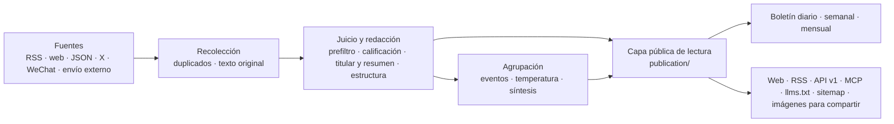

# Arquitectura



## Tres procesos

| Proceso | Ubicación | Qué hace |
|---|---|---|
| api | `apps/api/` | Fastify. Interfaces internas del sitio (`/api/site/`), API pública (`/api/v1/`), RSS, MCP, interfaces del panel, proxy de imágenes e imágenes para compartir |
| worker | `apps/worker/` | Cola de tareas y tareas programadas con pg-boss: lectura de fuentes, llamadas al modelo, agrupación, temperatura, boletines, alertas y limpieza |
| web | `apps/web/` | Páginas renderizadas en servidor con React Router. Solo lee la api por HTTP y nunca toca la base de datos |

La lógica de negocio está en `packages/backend/`, y los tipos y constantes compartidos entre frontend y backend en `packages/contracts/`. El nombre, los textos, la marca y las páginas del sitio están en `site/`; las categorías, fuentes, prompts y umbrales del sector en `industry/`, y las funciones exclusivas del sitio en `modules/` (ver "Módulos").

## Reglas que no cambian

- **Una sola capa pública de lectura**: la web, el RSS, la API, el MCP, el sitemap y las imágenes para compartir leen de `packages/backend/src/publication/`. El alcance público, los lugares de la selección (las salidas para máquinas publican una sola entrada por noticia) y las condiciones de evidencia de los hechos solo se definen en `publication/scope.ts`; cualquier salida nueva respeta también los retiros y los permisos de texto completo vigentes. Un boletín ya publicado conserva su redacción, pero si una cita puede mostrarse, el nombre de la fuente y la hora de la cita se deciden con los datos actuales; un retiro elimina también las introducciones y portadas que dependían de esa cita.
- **La caché no alarga la vida del contenido viejo**: el contenido que cambia se revalida al vencer su `Cache-Control`, y las cachés de proceso, disco y HTTP del sitemap comparten un mismo vencimiento que no se reinicia al enviarse; las respuestas HTTP del MCP usan `no-store`. Los proxys o CDN propios deben respetarlo; los requisitos están en "Dominio y HTTPS" de [Despliegue](deploy.md#dominio-y-https).
- **Las páginas no llaman al modelo**: al abrir una página solo se lee lo que ya está en la base; el modelo solo se llama dentro de tareas del worker.
- **Las peticiones de pago dejan comprobante**: cada petición de pago (modelo, X, WeChat, Jina) registra antes un comprobante y guarda el resultado antes de usarlo. Si el proceso se reinicia o la tarea se reintenta, se reutiliza lo ya pagado sin volver a gastar (`providers/receipts.ts`). Un comprobante con resultado incierto se libera solo una vez pasados 30 minutos, y las notas que quedaron detenidas por él vuelven a la cola para terminar la extracción o el análisis; si el resultado vuelve a ser incierto, un administrador lo revisa y lo libera desde la página "Ejecuciones".
- **Límites de presupuesto**: cada servicio de pago tiene topes por minuto, por hora y por día, y se detiene al superarlos (panel, "Configuración → Límites de peticiones de pago").
- **Válvulas de seguridad**: `COLLECT_ENABLED`, `MODEL_CALLS_ENABLED`, `FEISHU_CONTENT_PUSH_ENABLED`, `FEISHU_INTERNAL_ENABLED` e `INDEXNOW_SUBMIT_ENABLED` solo deciden si algo se envía o no, no qué lógica se ejecuta; solo se abren con `true` y, si no se definen, quedan cerradas. El `.env` que genera `scripts/init-env.ts` abre la recolección y las llamadas al modelo, que puedes poner en `false` si solo trabajas en la interfaz; en las pruebas los envíos siempre están cerrados y la recolección y el modelo solo hablan con servicios falsos locales.
- **El contenido público es anónimo**: administradores y visitantes ven lo mismo; los guardados y lo leído del lector se quedan en su navegador. El panel es solo para administradores.
- **Lo viejo no inunda la portada**: las notas publicadas hace más de 48 horas al descubrirse, el acervo de una fuente nueva en su primera importación y los envíos de relleno se archivan con su fecha original, sin entrar a "hoy" ni enviarse; tras la primera importación ya no se recogen notas anteriores del listado. Las notas sin fecha de publicación confiable no se publican hasta conocer su fecha.
- **Origen rastreable**: cada nota seleccionada enlaza al original; si el sitio muestra el texto completo lo decide `site_fulltext` de la fuente, y de forma predeterminada solo se muestra el resumen.
- **Cada regla la mantiene su módulo**: el panel llama a los módulos de contenido, eventos, notificaciones y recuperación sin reescribir su estado directamente, y los módulos de negocio no dependen del panel. Las ediciones manuales se guardan junto con el resultado público y los registros necesarios para recuperarlas.
- **Tipos compartidos entre procesos**: las interfaces del panel se rigen por `packages/contracts/src/admin.ts` y las cargas de tareas por `JobData` de `jobs/queue.ts`; emisor y receptor se revisan juntos. El frontend sigue accediendo al backend solo por HTTP.

`tests/architecture.test.ts` verifica estos límites entre módulos; si cambias un límite, actualiza la convención y la verificación al mismo tiempo. La identidad del sitio y el modelo de cada paso se leen de `site/`, y las categorías y prompts del sector de `industry/`; el código no fija valores de ningún sitio en particular.

## Directorios

| Ubicación | Contenido |
|---|---|
| `site/` | Lo propio del sitio: nombre y textos, modelo de cada paso, marca y logotipo, términos, los cuatro archivos fijos de la raíz (`public/`, publicados tras sustituir marcadores), registro de cambios y módulos activos (`site/modules/`) |
| `industry/` | Paquete del sector: categorías y etiquetas, temas, fuentes, prompts y umbrales |
| `modules/` | Funciones exclusivas del sitio, una carpeta por función (ver "Módulos"); el framework no trae módulos |
| `packages/backend/src/sources/` | Lectores de cada tipo de fuente y programación de lecturas (`collect.ts`) |
| `packages/backend/src/content/` | Ingreso de notas, duplicados, extracción y limpieza del texto |
| `packages/backend/src/editorial/` | Juicio y redacción: `analyze.ts` (flujo), `prompts.ts` (lectura de prompts), `models.ts` (modelo de cada paso) |
| `packages/backend/src/events/` | Agrupación de eventos, temperatura y síntesis |
| `packages/backend/src/publication/` | Capa pública de lectura |
| `packages/backend/src/reports/` | Boletines diario, semanal y mensual |
| `packages/backend/src/providers/` | Llamadas a modelos, embeddings, X, WeChat y Jina; comprobantes y presupuesto |
| `packages/backend/src/notify/` | Envíos a Feishu |
| `packages/backend/src/operations/` | Alertas, respaldos, limpieza e IndexNow |
| `packages/backend/src/admin/` | Interfaces del panel |
| `apps/web/app/routes/` | Un archivo por página; la tabla de rutas está en `apps/web/app/routes.ts` |
| `database/migrations/` | Migraciones, ejecutadas y registradas por nombre completo de archivo |
| `scripts/` | Inicialización, migraciones, datos semilla, evaluaciones y verificaciones |
| `tests/` | Pruebas del backend (la base debe terminar en `_test` o `_ci`; ver abajo) |

## Módulos

Una función que el framework no tiene y que solo necesita tu sitio (por ejemplo, un ranking o una página de monitoreo propia) se hace como módulo: una carpeta `modules/<nombre>/` por función, que es un paquete npm llamado `@aihot/<nombre>` con su propio backend, interfaces, páginas, estilos, migraciones y pruebas.

| Archivo | Contenido |
|---|---|
| `module.ts` | Sus direcciones: páginas, redirecciones y rutas que atiende la api (tipos en `packages/contracts/src/modules.ts`) |
| `server.ts` | Sus conexiones con el backend: interfaces, tareas programadas, colas, eventos y datos de páginas del panel (`packages/backend/src/modules.ts`, donde cada conexión indica qué archivo la lee) |
| `web.tsx` | Sus conexiones con la web: páginas, elementos del menú y componentes para temas y panel (`apps/web/app/modules.ts`); los componentes de una sola página exponen una función de carga y viajan con el código de esa página |
| `migrations/` | Sus tablas, ejecutadas junto con `database/migrations/` en orden de nombre |
| `tests/` | Sus pruebas, que corren con `npm test` |
| Otros archivos | Imágenes y archivos estáticos propios también van en la carpeta del módulo: se registra la ruta en la conexión `http` de `server.ts` y se envían con `sendFile` de `apps/api/src/routes/static.ts` (que resuelve tipo, ETag, caché y 404; el nombre del archivo lo valida el módulo), y la dirección se anota en `apiPaths` de `module.ts` |

Una vez escrito, se agrega a las tres listas de `site/modules/`: `index.ts` para direcciones, `server.ts` para backend y `web.ts` para la web, omitiendo la que no aplique; después se declara en `dependencies` de `site/package.json`. Si despliegas con Docker, agrega en el `Dockerfile` una línea como las de los demás paquetes: `COPY modules/<nombre>/package.json modules/<nombre>/`. El framework no importa ningún módulo, solo lee esas tres listas, así que al integrar actualizaciones del repositorio original es difícil que choquen con tus funciones. Si una conexión no alcanza, agrega una conexión genérica al framework en lugar de meter la función en él.

Los módulos ofrecen herramientas MCP mediante `agent.abilities`. `scripts/mcp-check.ts` siempre revisa el conjunto completo de herramientas; un módulo puede proporcionar en `mcp.checkArgs` argumentos que funcionen con una base vacía. Sin ellos, solo las herramientas cuyo esquema acepta `{}` se llaman con `{}`, y las demás solo se verifican en el descubrimiento, sin adivinar argumentos. El comportamiento de negocio de esas herramientas lo prueban las pruebas del propio módulo.

## Migraciones de base de datos

Las migraciones publicadas son historia del despliegue: no se reescriben ni se borran, y las correcciones van en archivos nuevos. El motor y los módulos siguen la misma convención: se ejecutan en orden por nombre completo de archivo, que también sirve para registrar si ya corrieron; dos archivos distintos con el mismo número se ejecutan por separado y un mismo nombre completo no puede existir en dos directorios. Desde `0055`, cada archivo contiene una sola sentencia apta para ejecutarse en línea; los PR rechazan migraciones nuevas que no cumplan y no permiten esquivar la revisión con un número menor. Así se evita que una sentencia bloquee una tabla y, en la misma transacción, espere a otra o recorra muchos datos.

Las columnas nuevas deben ser anulables o tener un valor predeterminado constante; para agregar CHECK o llaves foráneas a tablas existentes primero se usa `NOT VALID` y la validación va en otra migración. Los índices se crean con un `CREATE INDEX CONCURRENTLY IF NOT EXISTS` aparte, y las migraciones publicadas no hacen UPDATE o DELETE masivos ni los esconden en bloques DO. Los rellenos de datos se hacen aparte, por lotes y con observabilidad, probados antes sobre una copia de respaldo.

Cuando varios filtros están correlacionados y el plan de consulta subestima mucho las filas, se pueden crear estadísticas conjuntas MCV sobre esas columnas y, en otra migración, ejecutar `ANALYZE` sobre esas columnas de la tabla. Primero se verifica el beneficio con la distribución real; no se agregan estadísticas sin evidencia, ni se analiza toda la base en una migración, ni se da por buena una tabla bloqueada que se omitió.

Los cambios destructivos, como cambiar un tipo o borrar una columna, requieren pasos propios de actualización y reversión, y su efecto sobre los datos existentes se documenta en [Despliegue](deploy.md#actualizaciones); la revisión de migraciones en línea no los deja pasar directamente. Para una tabla que el código ya no usa, una vez confirmado que sus datos se pueden borrar, se escribe en una migración propia `DROP TABLE IF EXISTS <tabla>` (sin CASCADE, para que falle si algo todavía depende de ella) y se documenta igual en Despliegue. Para ampliar las sentencias permitidas hay que demostrar primero que no bloquearán por mucho tiempo las peticiones en servicio y agregar las verificaciones correspondientes; no se vale apagar la revisión ni modificar el registro anterior.

## Salidas públicas

Una relación `related` entre eventos necesita al menos dos coberturas que la sustenten al crearse. El historial de relaciones se conserva; si la cobertura que hace de puente se retira explícitamente, deja de ser una cobertura pública de hechos, pasa a ser una nota que reúne varios temas, se separa del hecho original o una agrupación posterior niega la relación, y la evidencia válida queda en menos de dos coberturas, la relación deja de mostrarse hasta que vuelva a haber evidencia suficiente. Que las coberturas salgan de la ventana de búsqueda o que una edición ordinaria conserve su pertenencia no hace vencer la relación. Las relaciones existentes sin un juicio de puente verificable no se dan por retiradas por falta de registro, y si el evento en sí no puede leerse públicamente, tampoco se recomienda. El significado de `storyline` no cambia con esta regla, y todas las salidas públicas comparten las mismas reglas de lectura.

| Dirección | Contenido |
|---|---|
| `/` `/all` `/hot` `/topics` `/daily` `/weekly` `/monthly` | Selección, todo, eventos en tendencia, temas y boletines diario, semanal y mensual |
| `/feed.xml` `/feed/full.xml` `/feed/all.xml` `/feed/daily.xml` `/feed/weekly.xml` `/feed/monthly.xml` | RSS: selección, selección con texto completo, todo, diario, semanal y mensual; además `/feed/category/<key>.xml` por categoría y su versión con texto completo `/feed/full/category/<key>.xml` |
| `/api/v1/` | API pública, documentada en `/openapi-v1.json`; el Markdown para agentes empieza en `/api/v1/agent` y la explicación está en `/agent` |
| `/api/mcp` | Servicio MCP con una herramienta para lo último, búsqueda, tendencias, eventos y cada boletín; el prefijo de las herramientas es `mcpPrefix` de `site/site.ts` (en Latido, `latido_`) |
| `/llms.txt` `/sitemap.xml` `/robots.txt` | Indicaciones para modelos de lenguaje y buscadores (`robots.txt` y los demás archivos raíz están en `site/public/`) |
| `/admin` | Panel |

## Pruebas

```bash
npm run typecheck
DATABASE_URL=postgres://127.0.0.1:5432/latido_test npm test
npm run build -w @aihot/web && npm run test:web
```

El nombre de la base en `DATABASE_URL` debe terminar en `_test` o `_ci`; si no existe se crea y se migra sola. Cada archivo de pruebas corre en paralelo sobre su propia copia, así que la cuenta de la base necesita permiso para crear bases (`CREATEDB`). Las pruebas no acceden a servicios externos: los modelos y las interfaces de pago los responden servicios falsos locales.
